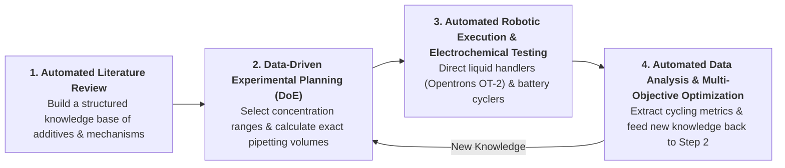

# Autonomous Materials Acceleration Platform (MAP) for Aqueous Zinc-Ion Batteries

[](https://www.python.org/downloads/)
[](https://zinc-ion-battery-map-bvpghpfevrln9egmrecfgr.streamlit.app/)
[](https://www.rdkit.org/)
[](LICENSE)

An interactive research platform designed to help **aqueous zinc-ion battery (ZIB)** researchers screen electrolyte additives from the literature, plan formulation experiments, prepare liquid-handling pipetting schedules, and analyze raw battery cycler data—all in one place.

🌐 **Try the App Online (No Installation Required):**  
👉 [Launch on Streamlit Community Cloud](https://zinc-ion-battery-map-bvpghpfevrln9egmrecfgr.streamlit.app/)

---

## 🚀 Quick Guide: What You Can Do in 5 Tabs

You do not need any programming experience to use this platform. Everything runs through an interactive web interface organized into five tabs:

* **Tab 1 — Automated Experiment Run (Demo Mode):**  
  Click **🚀 Run Autonomous Optimization Experiment** to watch a complete demonstration of an automated research workflow from start to finish. It transfers a literature additive, checks solubility limits, designs a multi-round experimental matrix, calculates robotic pipetting volumes, analyzes cell cycling data, and identifies the winning electrolyte recipe—all in one click, **100% offline** without needing your own files or API keys.
* **Tab 2 — Literature Search & Additive Finder (Step 1):**  
  Search peer-reviewed academic papers (via Semantic Scholar & OpenAlex) or upload PDF manuscripts to automatically extract tested electrolyte additives, optimal concentrations, baseline zinc salts, and protective mechanisms. The app then screens chemically similar candidate molecules and computes their water solubility limits via RDKit so you know what can actually be dissolved in the lab.  
  > 💡 **Strongly Recommended for Step 1 — Use a Free Google Gemini API Key:** While the Tab 1 closed-loop optimization simulation (**🚀 Run Autonomous Optimization Experiment**), RDKit solubility/similarity calculations, DoE formulation planning, OT-2 pipetting schedules, and Step 3 cycler data analysis all work **100% offline**, **getting a free Google Gemini API key is strongly recommended for Step 1 Literature Search & PDF Extraction**. Rule-based offline regex heuristics are only a basic fallback and cannot reliably extract baseline electrolytes, optimal concentrations, and mechanisms from arbitrary research papers. With a free Gemini API key ([get one in under 1 minute at Google AI Studio](https://aistudio.google.com/app/apikey)), the platform uses 5-paper batching on **gemini-3.5-flash-lite** / **gemini-3.1-flash-lite** to accurately analyze **up to 2,500 papers per day for free** (see the [1-Minute Setup Guide](#-getting-a-free-google-gemini-api-key-in-under-1-minute-strongly-recommended-for-step-1) below).
* **Tab 3 — Electrolyte Formulation & Pipetting Plan (Step 2):**  
  Choose your target zinc salt (such as **ZnSO₄**, **Zn(OTf)₂**, or **ZnCl₂**) and generate a balanced experimental grid (Design of Experiments) comparing additive concentration against salt molarity. The app automatically calculates exact stock-solution and water pipetting volumes (**µL**) for each vial and can export a ready-to-run schedule for an **Opentrons OT-2** liquid-handling robot.
* **Tab 4 — Battery Cycler Data Analysis (Step 3):**  
  Upload raw data files directly from **BioLogic** (`.mpr`, `.mpt`), **Neware**, **Landt**, **Arbin**, or **Excel/CSV** across five common battery testing techniques:
  * Galvanostatic **Zn//Zn** symmetric cells
  * Galvanostatic **Zn//Cu** or **Zn//Ti** asymmetric half-cells (Coulombic efficiency & nucleation overpotential)
  * Galvanostatic full cells (capacity retention & energy efficiency)
  * Cyclic Voltammetry (CV) and Linear Sweep Voltammetry (LSV)
  * Electrochemical Impedance Spectroscopy (EIS)
* **Tab 5 — Summary Report & Export (Step 4):**  
  Review the complete experimental audit trail, compare tested formulations side by side, and download structured summary reports in **Word (`.docx`)**, **Excel (`.xlsx`)**, **Plain Text (`.txt`)**, or **Interactive HTML** formats for group meetings and manuscript preparation.

*(Note: The interface also supports switching between **English**, **French**, and **Simplified Chinese** in the sidebar.)*

---

## 🔬 The Vision: Toward an Autonomous Lab for Zinc-Ion Batteries

Developing better electrolytes for aqueous zinc-ion batteries—to suppress hydrogen evolution (HER), prevent zinc dendrite short-circuits, and avoid surface passivation—traditionally requires months of repetitive manual work. 

This project was built as an attempt to develop a functional software foundation for an **Autonomous Self-Driving Laboratory (SDL)** supporting accelerated materials discovery. In a fully autonomous laboratory, the entire research cycle can operate as a continuous closed loop:



While **Demo Mode (Tab 1)** illustrates how this complete closed-loop workflow operates automatically from start to finish, **Tabs 2, 3, 4, and 5** are designed so that wet-lab researchers can immediately use each step independently in their daily research today.

---

## 💡 Why Use This App? (How It Speeds Up Research & Why It Is Reliable)

### How It Saves You Time in the Lab
* **Less Time Hunting Through Papers:** Quickly pull out exact additive concentrations, base electrolytes, current densities, and lifespans from literature PDFs without manually copying tables into spreadsheets.
* **No More Manual Dilution Math:** Automatically converts target molarities (**M** and **mM**) into exact microliter (**µL**) pipetting tables for 24-vial racks or 96-well plates, flagging any volumes below **5 µL** where pipetting accuracy drops.
* **Instant Cycler Data Processing:** Eliminates hours of repetitive spreadsheet work by reading native cycler files directly, normalizing current and capacity by electrode area, and generating publication-ready interactive plots in seconds.

### Why You Can Trust the Results (Scientific Reliability)
Wet-lab researchers rightly want to know that a software tool is grounded in real chemistry and electrochemistry rather than guesswork:

1. **Gold-Standard Cheminformatics (RDKit & PubChem) — No "Guessed" Chemistry:**  
   Instead of relying on an AI chatbot to guess chemical properties, this platform uses **RDKit** (the gold-standard open-source toolkit used across chemical and pharmaceutical research) and **NCBI PubChem** to verify molecular structures, compute molecular weight and polarity, and measure structural similarity using Morgan fingerprints. Water solubility limits are calculated using the peer-reviewed **Delaney ESOL equation** so the app will not suggest additive concentrations that precipitate out of water.
2. **Evidence-Backed Literature Extraction (Inspired by PaperQA2 & LeMat-Synth):**  
   Whenever the app extracts an additive concentration or cycling metric from a paper, it is required to extract the **exact verbatim quote** from the text and standardize the concentration units (**mM**, **M**, **wt%**, **vol%**). You can always verify the original sentence right inside the table.
3. **Built-In Zinc-Ion Battery Chemistry Rules:**  
   The experimental planner adjusts additive exploration windows based on the specific zinc salt you select (**ZnSO₄**, **Zn(OTf)₂**, **Zn(ClO₄)₂**, **Zn(TFSI)₂**, **ZnCl₂**, or **Zn(CH₃COO)₂**), caps concentrations at **80%** of the aqueous solubility ceiling, and automatically reduces Opentrons OT-2 pipetting speeds by **50%** when dispensing high-viscosity electrolytes like **ZnCl₂** or **Zn(TFSI)₂**.
4. **Validated Battery Math & True Failure Detection (Built on cellpy & NREL's ampworks):**  
   Cycler file decoding and differential capacity analysis (**dQ/dV** and **dV/dQ**) build upon established open-source battery libraries (**cellpy** and NREL's **ampworks**). In addition, the app solves a common problem in **Zn//Zn** symmetric cell testing: when a cell short-circuits from dendrites (voltage drops near **0 mV**), a cycler can keep recording data for hundreds of hours and falsely inflate the reported lifespan. This app automatically detects both **dendrite short-circuits** (**< 5 mV**) and **byproduct passivation spikes** (**≥ 1.0 V**), trims initial open-circuit rest periods so **t = 0** starts when current actually flows, and reports **healthy active cycling metrics** separately from total test duration.
5. **Verified by 291+ Automated Quality Checks:**  
   Every calculation in the platform—from unit conversions and pipetting dilutions to Coulombic efficiency, energy efficiency integration, and failure detection—is verified by an automated test suite (`tests/`) to ensure consistent, reproducible numbers.

---

## 🎛️ Plain-Language Guide to Sidebar & Experiment Controls

Whether you are a wet-lab battery student or exploring the platform for the first time, here is what every control in the left-hand **MAP Control Center** sidebar does in everyday language:

### 1. Operating Mode
* **Demo Mode (Pre-loaded Literature Data):** Opens all **5 tabs**, pre-loaded with benchmark zinc-ion battery literature data, curated additives, and simulated multi-round cycling campaigns. In this mode, all sidebar experiment controls are unlocked so you can tweak the target salt, additive, or optimization settings and click **🚀 Run Autonomous Optimization Experiment** in Tab 1 to watch a complete closed-loop self-driving lab simulation and export full campaign reports (Tab 5).
* **Custom Experiment Mode:** Switches the interface to a streamlined **3-tab wet-lab workspace** (*Step 1: Literature Search & Additive Finder*, *Step 2: Electrolyte Formulation & Experiment Planning*, and *Step 3: Battery Cycling & Failure Analysis*). Pre-loaded demo data is hidden so you can start with a clean slate for your own searched papers, uploaded PDFs, custom SMILES molecules, and raw cycler files.

### 2. Knowledge Transfer & Formulation Setup
In battery research, an additive is often discovered in a standard electrolyte (like **2 M ZnSO₄**), but you may want to test it in a different electrolyte system. Simply copying the exact same concentration rarely works because different salts change how water molecules and zinc ions behave.
* **Target Electrolyte to Optimize:** Choose which aqueous zinc salt you want to formulate in the lab:
  * **ZnSO₄** (*Zinc Sulfate, default 2.0 M, range 1.0–3.0 M*) — The standard, low-cost baseline salt; prone to basic zinc sulfate byproduct passivation.
  * **Zn(OTf)₂** (*Zinc Triflate, default 1.0 M, range 0.5–2.5 M*) — Bulky fluorinated anions that help form protective **ZnF₂**-rich surface layers, typically needing ~30% less organic additive than **ZnSO₄**.
  * **Zn(ClO₄)₂** (*Zinc Perchlorate, default 2.0 M, range 1.0–3.5 M*) — Weakly coordinating anions for fast **Zn²⁺** desolvation and high-rate/low-temperature performance.
  * **Zn(TFSI)₂** (*Water-in-Salt / WiSE, default 4.0 M, range 2.0–7.5 M*) — Highly concentrated fluorinated electrolyte where most water is already bound to salt ions, requiring lower additive dosages.
  * **ZnCl₂** (*Zinc Chloride, default 5.0 M, range 2.0–10.0 M*) — Concentrated, viscous chloride electrolyte that compresses the electrical double layer and often requires higher additive concentrations.
  * **Zn(CH₃COO)₂** (*Zinc Acetate, default 1.0 M, range 0.5–2.5 M*) — Mild pH-buffered electrolyte (**pH ≈ 5–6**) that naturally suppresses hydrogen gas evolution.
* **Additive to Test (from Literature):** Pick a benchmark additive from the curated pool (such as *Trehalose*, *TEABr*, *D-Sorbitol*, *Thiourea*, or *Glucose*) to optimize in Demo Mode.
* **Reported Additive Conc (mM) & Literature Baseline Electrolyte:** Enter the optimal concentration (e.g., **15.0 mM**) and original salt (e.g., **2 M ZnSO₄**) reported in the source paper.  
  * **Why Concentration Scaling + the 80% Delaney ESOL Cap Matter:** First, the platform scales the reported concentration up or down based on the chemical differences between the paper's baseline salt and your chosen target salt. Second, it calculates the molecule's theoretical water solubility using **RDKit's Delaney ESOL equation** and enforces a strict **80% solubility safety ceiling**. Because concentrated zinc salts leave less "free water" available to dissolve organic molecules, staying below 80% saturation prevents your additive from precipitating or crystallizing out of solution during battery cycling.

### 3. Automated Optimization & Active Learning
* **Optimization Rounds (1 to 4):**
  * **1 Round (Single Screening Pass):** Generates a single initial batch of electrolyte recipes to screen across your safe concentration window.
  * **2 to 4 Rounds (Closed-Loop Active Learning):** Runs an iterative self-driving loop. **Round 1** screens an initial spread of recipes; then **Rounds 2, 3, and 4** analyze how long each battery actually lasted and its voltage loss (overpotential), automatically proposing smarter follow-up recipes to zero in on the best-performing formulation.
* **Experimental Design Method (DoE) — How Round 1 Picks Recipes:**
  * **Latin Hypercube (LHS — Uniform Coverage):** Divides the entire safe range of additive concentration (**mM**) and salt concentration (**M**) into an even chessboard-like grid and places samples so that no two vials share the same row or column. **When to choose LHS:** Best when you are exploring a new additive or salt for the first time and want broad, even, space-filling coverage across the whole concentration map with any number of vials (**3–12**).
  * **Central Composite (CCD — Surface Response):** Builds a structured geometric pattern anchored right around your scaled literature recipe—testing the **4 corners** of the box (factorial points), **4 extreme edges** along the axes (star/axial points), and **repeated center points** right at the middle. **When to choose CCD:** Best when you already have a trusted literature concentration and want to map curved cause-and-effect relationships (for example, when too little additive fails to stop dendrites, while too much increases viscosity and voltage polarization) to pinpoint the exact peak.
* **Initial Formulations (Batch 1) (3–12) vs. Follow-up Formulations per Round (1–6):**
  * **Initial Formulations (Batch 1) (3–12):** How many electrolyte vials are prepared and tested in Round 1 to build your initial map.
  * **Follow-up Formulations per Round (1–6):** *(Unlocked when Optimization Rounds ≥ 2)* How many new AI-guided electrolyte vials are mixed in each follow-up round based on what the algorithm learned from the previous round's cycling data.
* **Active Learning Optimization Focus:** *(Unlocked when Optimization Rounds ≥ 2)* Controls how the algorithm chooses follow-up recipes after seeing which Round 1 vial performed best:
  * **Fastest Improvement (Near Top Performer):** Takes bolder steps outward in the direction of the winning recipe to quickly see if higher or lower concentrations unlock even bigger gains.
  * **Refinement (Fill High-Performing Region):** Zooms in tightly around the current best recipe with small concentration steps to fine-tune the exact sweet spot.
  * **Balanced (Explore & Refine):** Splits follow-up vials between testing unexplored gaps in the middle and pushing slightly past the current best performer.

### 4. Hardware & Liquid Handling
* **Robotic Liquid Handler Rack (24-vial rack vs. 96-well plate):**
  * **24-vial rack (4 rows A–D × 6 columns 1–6):** Standard glass scintillation vials typically used for mixing larger electrolyte batches (**1,000–5,000 µL**) for coin-cell or pouch-cell assembly.
  * **96-well plate (8 rows A–H × 12 columns 1–12):** High-throughput microplate layout suited for rapid, small-volume screening (**100–300 µL** per well).
* **Target Electrolyte Volume per Vial (µL) (50 to 10,000 µL):** The final liquid volume you want in each vial or well (defaults to **2,000 µL** for a 24-vial rack or **200 µL** for a 96-well plate). The platform automatically calculates exact microliter (**µL**) transfers of salt stock, additive stock, and DI water so every vial adds up to this exact target volume.

---

## 💻 Running the App on Your Own Computer

If you prefer to run the platform locally on your own computer rather than on the web:

### Step 1: Install Python
Make sure you have **Python 3.11 or 3.12** installed from [python.org](https://www.python.org/downloads/). *(During installation on Windows, check the box that says **"Add Python to PATH"**).*

### Step 2: Download This Repository
Click the green **"Code"** button at the top of this GitHub page and select **"Download ZIP"** (then unzip the folder on your computer), or clone it using Git:
```bash
git clone https://github.com/MarkJYCui/zinc-ion-battery-map.git
cd zinc-ion-battery-map
```

### Step 3: Install the Required Packages & Launch
* **On Windows (Easiest — One-Click Launcher):**  
  Simply double-click **`run_app.bat`** (or right-click **`run_app.ps1`** and run with PowerShell). If you already have a Python environment set up, it will launch the app directly in your web browser.
* **Manual Setup (Windows, Mac, or Linux via Terminal / Command Prompt):**  
  Open a terminal inside the project folder and run:
  ```bash
  # 1. Create a clean virtual environment
  python -m venv .venv

  # 2. Activate the environment
  # On Windows:
  .venv\Scripts\activate
  # On Mac / Linux:
  source .venv/bin/activate

  # 3. Install the required scientific packages
  pip install -r requirements.txt

  # 4. Start the app
  streamlit run app.py
  ```
  The app will automatically open in your web browser at `http://localhost:8501`.

### 🔑 Getting a Free Google Gemini API Key in Under 1 Minute (Strongly Recommended for Step 1)
> [!IMPORTANT]
> **What works 100% offline vs. what needs an API key:**  
> The Tab 1 closed-loop optimization simulation (**🚀 Run Autonomous Optimization Experiment**), RDKit solubility & molecular similarity calculations, DoE formulation planning, Opentrons OT-2 pipetting schedules, and all Step 3 battery cycler data analyses & report exports work **100% offline** with zero API keys required.  
> However, **getting a free Google Gemini API key is strongly recommended for Step 1 Literature Search & PDF Extraction**. Without an API key, Step 1 falls back to basic rule-based offline regex heuristics, which cannot reliably extract baseline electrolytes, optimal concentrations, or mechanisms from arbitrary scientific papers.

Anyone can get a free Gemini API key in **under 1 minute** (no credit card required):
1. **Generate a Free Key:** Visit **[Google AI Studio (https://aistudio.google.com/app/apikey)](https://aistudio.google.com/app/apikey)**, sign in with any Google account, and click **"Create API key"**.
2. **Open the Key Popover in Step 1:** In the app, go to **Step 1: Literature Search & Additive Finder** and click the **🔑 Configure Gemini API Key** (**🔑 Gemini API Key**) popover button next to the search bar.
3. **Paste & Save:** Paste your key (`AIzaSy...`), keep the default **gemini-3.5-flash-lite** (or **gemini-3.1-flash-lite**) model selected, and click **💾 Save Key**. Because the app batches **5 papers per API request**, a single free-tier key (500 requests/day) supports analyzing **up to 2,500 papers per day for free**!

*(Optional for local installations: You can also save your key permanently on your own computer by copying `.env.example` to `.env` and setting `GEMINI_API_KEY=your_api_key_here`.)*

---

## 🙏 Acknowledgments & Open-Source Attributions

Science and engineering move forward faster when we build on each other's work. Coming from an experimental background in zinc-air and zinc-ion battery research, developing this platform was made possible by combining domain experience in electrochemistry with modern AI-assisted development tools and the generous work of the open-source scientific community.

In particular, this platform adapts and builds upon code and methodologies from five open-source scientific projects. Their original license texts are preserved in the [`third_party_licenses/`](third_party_licenses/) folder and within the corresponding source files:

* **[ampworks](https://github.com/NREL/ampworks)** *(National Renewable Energy Laboratory / NREL, BSD-3-Clause License)* — Incremental Capacity Analysis (**dQ/dV**) and Differential Voltage Analysis (**dV/dQ**) algorithms (`analysis/processing/math_engine.py`; license at [`third_party_licenses/ampworks_LICENSE.txt`](third_party_licenses/ampworks_LICENSE.txt)).
* **[cellpy](https://github.com/jepegit/cellpy)** *(jepegit & cellpy developers, MIT License)* — BioLogic `.mpr` binary file decoding and electrochemical cycle splitting/summary extraction (`analysis/parsers/` and `analysis/processing/math_engine.py`; license at [`third_party_licenses/cellpy_LICENSE.txt`](third_party_licenses/cellpy_LICENSE.txt)).
* **[ChemCrow](https://github.com/ur-whitelab/chemcrow-public)** *(White Lab, MIT License)* — RDKit Morgan/Tanimoto molecular similarity screening and PubChem chemical structure resolution (`discovery/similarity.py` and `discovery/pubchem_client.py`; license at [`third_party_licenses/ChemCrow-LICENSE.txt`](third_party_licenses/ChemCrow-LICENSE.txt)).
* **[LeMat-Synth](https://github.com/LeMaterial/lematerial-llm-synthesis)** *(LeMaterial Team, Apache 2.0 License)* — Structured multi-paper synthesis condition extraction and verification schemas (`discovery/domain_config.py` and `discovery/extractor.py`; license at [`third_party_licenses/LeMat-Synth-LICENSE.txt`](third_party_licenses/LeMat-Synth-LICENSE.txt)).
* **[PaperQA2](https://github.com/Future-House/paper-qa)** *(FutureHouse, Apache 2.0 License)* — Scientific text cleaning, chunking, relevance scoring, and citation-grounded extraction patterns (`discovery/extractor.py`; license at [`third_party_licenses/PaperQA2-LICENSE.txt`](third_party_licenses/PaperQA2-LICENSE.txt)).

---

## 📄 License

This project is released under the **MIT License**. Third-party components adapted in this repository remain governed by their respective licenses in [`third_party_licenses/`](third_party_licenses/).
