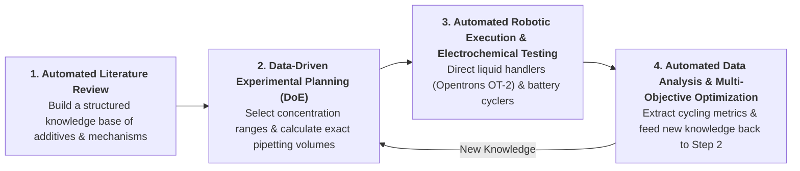

# Autonomous Materials Acceleration Platform (MAP) for Aqueous Zinc-Ion Batteries

[](https://www.python.org/downloads/)
[](https://zinc-ion-battery-map-bvpghpfevrln9egmrecfgr.streamlit.app/)
[](https://www.rdkit.org/)
[](LICENSE)

An interactive research platform designed to help **aqueous zinc-ion battery (ZIB)** researchers screen electrolyte additives from the literature, plan formulation experiments, prepare liquid-handling pipetting schedules, and analyze raw battery cycler data—all in one place.

🌐 **Try the App Online (No Installation Required):**  
👉 [Launch on Streamlit Community Cloud](https://zinc-ion-battery-map-bvpghpfevrln9egmrecfgr.streamlit.app/)

---

## 🚀 Quick Guide: What You Can Do in 5 Tabs

You do not need any programming experience to use this platform. Everything runs through an interactive web interface organized into five tabs:

* **Tab 1 — Automated Closed-Loop Run (Demo Mode):**  
  Click **"Run Autonomous Campaign"** to watch a complete demonstration of an automated research workflow from start to finish. It searches for an additive, designs an experimental matrix, calculates robotic pipetting volumes, analyzes the resulting cell cycling data, and identifies the best electrolyte recipe—all in one click, without needing your own files or API keys.
* **Tab 2 — Literature & Additive Discovery (Step 1):**  
  Search open-access academic papers or upload a PDF manuscript to automatically extract tested electrolyte additives, optimal concentrations, base salts, and cycling performance. The app then screens chemically similar candidate molecules and estimates their water solubility limits so you know what can actually be dissolved in the lab.
* **Tab 3 — Electrolyte Formulation & Pipetting Plan (Step 2):**  
  Choose your target zinc salt (such as $\text{ZnSO}_4$, $\text{Zn(OTf)}_2$, or $\text{ZnCl}_2$) and generate a balanced experimental grid (Design of Experiments) comparing additive concentration against salt molarity. The app automatically calculates exact stock-solution and water pipetting volumes ($\mu\text{L}$) for each vial and can export a ready-to-run schedule for an **Opentrons OT-2** liquid-handling robot.
* **Tab 4 — Battery Cycler Data Analysis (Step 3):**  
  Upload raw data files directly from **BioLogic** (`.mpr`, `.mpt`), **Neware**, **Landt**, **Arbin**, or **Excel/CSV** across five common battery testing techniques:
  * Galvanostatic $\text{Zn//Zn}$ symmetric cells
  * Galvanostatic $\text{Zn//Cu}$ or $\text{Zn//Ti}$ asymmetric half-cells (Coulombic efficiency & nucleation overpotential)
  * Galvanostatic full cells (capacity retention & energy efficiency)
  * Cyclic Voltammetry (CV) and Linear Sweep Voltammetry (LSV)
  * Electrochemical Impedance Spectroscopy (EIS)
* **Tab 5 — Summary Report & Export (Step 4):**  
  Review the complete experimental audit trail, compare tested formulations side by side, and download structured summary reports in **Word (`.docx`)**, **Excel (`.xlsx`)**, **Plain Text (`.txt`)**, or **Interactive HTML** formats for group meetings and manuscript preparation.

*(Note: The interface also supports switching between **English**, **French**, and **Simplified Chinese** in the sidebar.)*

---

## 🔬 The Vision: Toward an Autonomous Lab for Zinc-Ion Batteries

Developing better electrolytes for aqueous zinc-ion batteries—to suppress hydrogen evolution (HER), prevent zinc dendrite short-circuits, and avoid surface passivation—traditionally requires months of repetitive manual work. 

This project was built as an attempt to develop a functional software foundation for an **Autonomous Self-Driving Laboratory (SDL)** supporting accelerated materials discovery. In a fully autonomous laboratory, the entire research cycle can operate as a continuous closed loop:



While **Demo Mode (Tab 1)** illustrates how this complete closed-loop workflow operates automatically from start to finish, **Tabs 2, 3, 4, and 5** are designed so that wet-lab researchers can immediately use each step independently in their daily research today.

---

## 💡 Why Use This App? (How It Speeds Up Research & Why It Is Reliable)

### How It Saves You Time in the Lab
* **Less Time Hunting Through Papers:** Quickly pull out exact additive concentrations, base electrolytes, current densities, and lifespans from literature PDFs without manually copying tables into spreadsheets.
* **No More Manual Dilution Math:** Automatically converts target molarities ($\text{M}$ and $\text{mM}$) into exact microliter ($\mu\text{L}$) pipetting tables for 24-vial racks or 96-well plates, flagging any volumes below $5\ \mu\text{L}$ where pipetting accuracy drops.
* **Instant Cycler Data Processing:** Eliminates hours of repetitive spreadsheet work by reading native cycler files directly, normalizing current and capacity by electrode area, and generating publication-ready interactive plots in seconds.

### Why You Can Trust the Results (Scientific Reliability)
Wet-lab researchers rightly want to know that a software tool is grounded in real chemistry and electrochemistry rather than guesswork:

1. **Gold-Standard Cheminformatics (`RDKit` & `PubChem`) — No "Guessed" Chemistry:**  
   Instead of relying on an AI chatbot to guess chemical properties, this platform uses **RDKit** (the gold-standard open-source toolkit used across chemical and pharmaceutical research) and **NCBI PubChem** to verify molecular structures, compute molecular weight and polarity, and measure structural similarity using Morgan fingerprints. Water solubility limits are calculated using the peer-reviewed **Delaney ESOL equation** so the app will not suggest additive concentrations that precipitate out of water.
2. **Evidence-Backed Literature Extraction (Inspired by `PaperQA2` & `LeMat-Synth`):**  
   Whenever the app extracts an additive concentration or cycling metric from a paper, it is required to extract the **exact verbatim quote** from the text and standardize the concentration units (`mM`, `M`, `wt%`, `vol%`). You can always verify the original sentence right inside the table.
3. **Built-In Zinc-Ion Battery Chemistry Rules:**  
   The experimental planner adjusts additive exploration windows based on the specific zinc salt you select ($\text{ZnSO}_4$, $\text{Zn(OTf)}_2$, $\text{Zn(ClO}_4)_2$, $\text{Zn(TFSI)}_2$, $\text{ZnCl}_2$, or $\text{Zn(CH}_3\text{COO)}_2$), caps concentrations at $80\%$ of the aqueous solubility ceiling, and automatically reduces Opentrons OT-2 pipetting speeds by $50\%$ when dispensing high-viscosity electrolytes like $\text{ZnCl}_2$ or $\text{Zn(TFSI)}_2$.
4. **Validated Battery Math & True Failure Detection (Built on `cellpy` & NREL's `ampworks`):**  
   Cycler file decoding and differential capacity analysis ($dQ/dV$ and $dV/dQ$) build upon established open-source battery libraries (`cellpy` and NREL's `ampworks`). In addition, the app solves a common problem in $\text{Zn//Zn}$ symmetric cell testing: when a cell short-circuits from dendrites (voltage drops near $0\text{ mV}$), a cycler can keep recording data for hundreds of hours and falsely inflate the reported lifespan. This app automatically detects both **dendrite short-circuits** ($< 5\text{ mV}$) and **byproduct passivation spikes** ($\ge 1.0\text{ V}$), trims initial open-circuit rest periods so $t=0$ starts when current actually flows, and reports **healthy active cycling metrics** separately from total test duration.
5. **Verified by 274 Automated Quality Checks:**  
   Every calculation in the platform—from unit conversions and pipetting dilutions to Coulombic efficiency, energy efficiency integration, and failure detection—is verified by an automated test suite (`tests/`) to ensure consistent, reproducible numbers.

---

## 💻 Running the App on Your Own Computer

If you prefer to run the platform locally on your own computer rather than on the web:

### Step 1: Install Python
Make sure you have **Python 3.11 or 3.12** installed from [python.org](https://www.python.org/downloads/). *(During installation on Windows, check the box that says **"Add Python to PATH"**).*

### Step 2: Download This Repository
Click the green **"Code"** button at the top of this GitHub page and select **"Download ZIP"** (then unzip the folder on your computer), or clone it using Git:
```bash
git clone https://github.com/MarkJYCui/zinc-ion-battery-map.git
cd zinc-ion-battery-map
```

### Step 3: Install the Required Packages & Launch
* **On Windows (Easiest — One-Click Launcher):**  
  Simply double-click **`run_app.bat`** (or right-click **`run_app.ps1`** and run with PowerShell). If you already have a Python environment set up, it will launch the app directly in your web browser.
* **Manual Setup (Windows, Mac, or Linux via Terminal / Command Prompt):**  
  Open a terminal inside the project folder and run:
  ```bash
  # 1. Create a clean virtual environment
  python -m venv .venv

  # 2. Activate the environment
  # On Windows:
  .venv\Scripts\activate
  # On Mac / Linux:
  source .venv/bin/activate

  # 3. Install the required scientific packages
  pip install -r requirements.txt

  # 4. Start the app
  streamlit run app.py
  ```
  The app will automatically open in your web browser at `http://localhost:8501`.

### Step 4 (Optional): Add a Gemini API Key for Live Paper Reading
All offline features—including **Demo Mode**, **RDKit molecular screening**, **Design of Experiments**, **Opentrons pipetting schedules**, and **all Cycler Data Analysis & Report Exports**—work immediately **without** any API key.  
If you want to use live AI extraction on new PDF papers in Tab 2, you can either paste a free [Google Gemini API key](https://aistudio.google.com/) directly in the app's sidebar, or copy `.env.example` to a new file named `.env` and add your key there:
```text
GEMINI_API_KEY=your_api_key_here
```

---

## 🙏 Acknowledgments & Open-Source Attributions

Science and engineering move forward faster when we build on each other's work. Coming from an experimental background in zinc-air and zinc-ion battery research, developing this platform was made possible by combining domain experience in electrochemistry with modern AI-assisted development tools and the generous work of the open-source scientific community.

In particular, this platform adapts and builds upon code and methodologies from five open-source scientific projects. Their original license texts are preserved in the [`third_party_licenses/`](third_party_licenses/) folder and within the corresponding source files:

* **[ampworks](https://github.com/NREL/ampworks)** *(National Renewable Energy Laboratory / NREL, BSD-3-Clause License)* — Incremental Capacity Analysis ($dQ/dV$) and Differential Voltage Analysis ($dV/dQ$) algorithms (`analysis/processing/math_engine.py`; license at [`third_party_licenses/ampworks_LICENSE.txt`](third_party_licenses/ampworks_LICENSE.txt)).
* **[cellpy](https://github.com/jepegit/cellpy)** *(jepegit & cellpy developers, MIT License)* — BioLogic `.mpr` binary file decoding and electrochemical cycle splitting/summary extraction (`analysis/parsers/` and `analysis/processing/math_engine.py`; license at [`third_party_licenses/cellpy_LICENSE.txt`](third_party_licenses/cellpy_LICENSE.txt)).
* **[ChemCrow](https://github.com/ur-whitelab/chemcrow-public)** *(White Lab, MIT License)* — RDKit Morgan/Tanimoto molecular similarity screening and PubChem chemical structure resolution (`discovery/similarity.py` and `discovery/pubchem_client.py`; license at [`third_party_licenses/ChemCrow-LICENSE.txt`](third_party_licenses/ChemCrow-LICENSE.txt)).
* **[LeMat-Synth](https://github.com/LeMaterial/lematerial-llm-synthesis)** *(LeMaterial Team, Apache 2.0 License)* — Structured multi-paper synthesis condition extraction and verification schemas (`discovery/domain_config.py` and `discovery/extractor.py`; license at [`third_party_licenses/LeMat-Synth-LICENSE.txt`](third_party_licenses/LeMat-Synth-LICENSE.txt)).
* **[PaperQA2](https://github.com/Future-House/paper-qa)** *(FutureHouse, Apache 2.0 License)* — Scientific text cleaning, chunking, relevance scoring, and citation-grounded extraction patterns (`discovery/extractor.py`; license at [`third_party_licenses/PaperQA2-LICENSE.txt`](third_party_licenses/PaperQA2-LICENSE.txt)).

---

## 📄 License

This project is released under the **MIT License**. Third-party components adapted in this repository remain governed by their respective licenses in [`third_party_licenses/`](third_party_licenses/).
